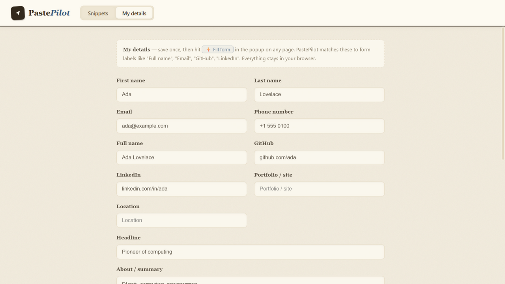
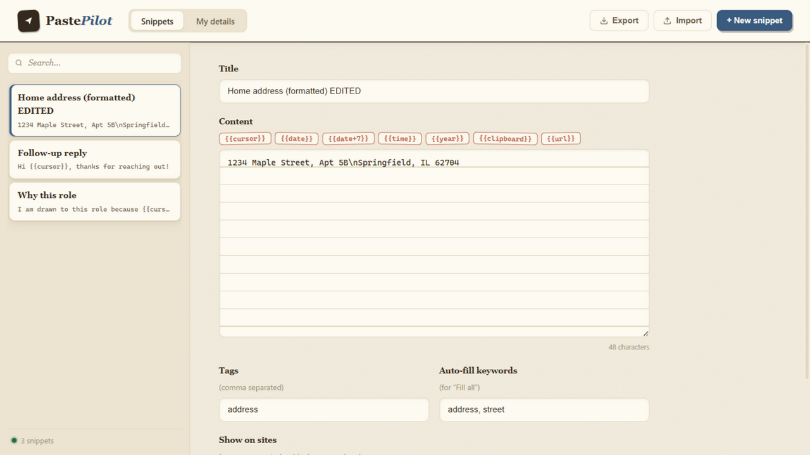

<div align="center">

# ✈️ PastePilot — Site-Aware Snippets

**The text you paste every day, one click away — filled straight into the page you're on.**

[](https://github.com/Gaurav77Kumar/PastePilot/actions/workflows/ci.yml)



Save your details and snippets once. PastePilot fills them into any form field —
job applications, checkout addresses, support replies — without ever leaving the page.

</div>

## Why PastePilot?

Every day you retype the same things: your address on checkout forms, the same
answer on every job application, the same follow-up reply in support inboxes.
PastePilot keeps that text one click away — and because it knows which site
you're on, the right snippet is always at the top of the list.

- **Site-aware snippets** — pin a snippet to `linkedin.com`, `*.google.com`, or any
  domain; it shows first where it belongs and stays out of the way elsewhere
- **My details** — save your name, email, phone, GitHub and LinkedIn once, then fill
  whole forms in one click. Label matching understands "Full name", "Email",
  "Notice period", custom fields — anything you name
- **Quick-pick** — press <kbd>Ctrl</kbd>+<kbd>Shift</kbd>+<kbd>S</kbd> inside any field for an
  in-page menu: type to filter, Enter to fill. Your caret lands exactly where
  the snippet's `{{cursor}}` marker is
- **Framework-safe** — filling uses native value setters and fires real `input`
  events, so React, Vue and other JS forms register the change
- **Template variables** — `{{date}}`, `{{date+7}}`, `{{time}}`, `{{year}}`,
  `{{url}}`, `{{clipboard}}` and `{{cursor}}` resolve at fill time
- **Private by design** — no accounts, no servers, no analytics. Data lives in
  your browser and follows you across devices through Chrome Sync

Manifest V3 · vanilla JS · zero dependencies · no build step.

## Install

**From the Chrome Web Store** — link added once review completes.

**From source** (any Chromium browser):

1. Download or clone this repo
2. Open `chrome://extensions`, enable **Developer mode**
3. **Load unpacked** → select this folder (the one containing `manifest.json`)
4. Click the PastePilot icon on any page, or press <kbd>Ctrl</kbd>+<kbd>Shift</kbd>+<kbd>S</kbd> in a form field

## How it works

| Surface | What you do |
|---|---|
| **Popup** (icon click) | Search snippets, see what's relevant for the current site, click to fill the focused field — or hit **⚡ Fill form** to fill every matching empty field at once |
| **Quick-pick** (<kbd>Ctrl</kbd>+<kbd>Shift</kbd>+<kbd>S</kbd>) | In-page overlay inside the field you're typing in; filter and Enter |
| **Editor** (Manage / options page) | Create snippets, set tags, site rules and auto-fill keywords, manage custom detail fields |



### Template variables

| Variable | Fills in |
|---|---|
| `{{date}}` | Today, in your locale format |
| `{{date+7}}` / `{{date-1}}` | Date shifted by days |
| `{{time}}` | Current time |
| `{{year}}` | Four-digit year |
| `{{url}}` / `{{title}}` | URL / title of the page being filled |
| `{{clipboard}}` | Whatever is on your clipboard at fill time |
| `{{cursor}}` | Where your caret lands after filling |

## Privacy

PastePilot collects **nothing**. It requests only `activeTab`, `scripting` and
`storage` — no broad host permissions, no background page access, no remote
code. Snippets never leave your browser. Full policy:
[docs/privacy-policy.md](docs/privacy-policy.md).

## Development

No dependencies to install — you only need Node 18+.

```
npm run check    # node --check every JS file
npm test         # unit tests + store-readiness gates (manifest, icons, MV3 CSP)
npm run package  # build dist/pastepilot-v<version>.zip for the Chrome Web Store
npm run verify   # all three — this is what CI runs
```

```
.github/   CI workflow (runs on every push/PR; v* tags publish a release zip)
docs/      privacy policy (+ screenshots)
lib/       storage, site rules, variables, page-fill engine, identity profile
popup/     popup UI          editor/    snippet manager (options page)
content/   in-page quick-pick overlay, injected on demand
test/      local QA form (python -m http.server, then open /test/form.html)
```

CI gates are store-aware on purpose: the manifest's name/description limits,
icon sizes, permission set and CSP rules are all asserted by tests, so a
change that would get the extension rejected can't be pushed silently.
`npm run package` produces a store-ready zip with `manifest.json` at the root
and all development files excluded.

## Versioning & releases

1. Bump `version` in `manifest.json`
2. Commit and tag: `git tag v1.0.1 && git push origin main --tags`
3. CI builds the zip and attaches it to a GitHub Release automatically —
   upload that zip in the [Developer Console](https://chrome.google.com/webstore/devconsole)
